# FixProof — Final Project Report & Technical Submission

**Project Name:** FixProof — Autonomous Sports Media Copyright Intelligence & Digital Forensics  
**Repository:** [https://github.com/varunchauhan12/FIXPROOF](https://github.com/varunchauhan12/FIXPROOF)  
**Live Backend Service (Google Cloud Run):** [https://fixproof-git-214713402646.europe-west1.run.app](https://fixproof-git-214713402646.europe-west1.run.app)  
**Submission Category:** NVIDIA AI Hackathon 2026 — Multimodal AI & Autonomous Agents  
**Date of Audit:** October 29, 2026  

---

## 1. Executive Summary

FixProof is an enterprise-grade digital forensics and visual copyright intelligence platform tailored for high-value live sports broadcasts. Live sports rights represent billions of dollars in premium broadcast contracts, yet sports rights-holders face unprecedented piracy challenges: unauthorized low-latency live restreaming, automated clip harvesting across TikTok, YouTube, and X, horizontal mirror-flipping, crop-tampering, and speed perturbations designed to evade conventional Content ID systems.

Unlike legacy copyright crawlers that treat raw hash collisions as definitive infringement, FixProof introduces a **defense-in-depth forensic verification architecture**:
1. **High-Throughput Sub-Second Screening**: Keyframe feature extraction using a MobileNetV3-Small neural backbone producing 576-dimensional L2-normalized vectors indexed in FAISS (`IndexFlatL2`), paired with perceptual hashing (pHash) and Shannon entropy solid-frame filtering.
2. **Multimodal AI Grounding**: Integration of NVIDIA Nemotron models hosted on Nebius Token Factory (`nvidia/Nemotron-3_5-Lightning`, `nvidia/Nemotron-3.5-Super-VL`, and `nvidia/nemotron-3-super-120b-a12b`) for pairwise visual verification, temporal continuity reasoning, and structured forensic intelligence generation.
3. **Cryptographic Chain of Custody**: Generation of tamper-evident, RFC 8785-canonicalized, Ed25519-signed evidence packages with SHA-256 rolling chain-of-custody ledgers, accompanied by court-ready ReportLab PDF dossiers.
4. **Human-in-the-Loop Action Center**: Dual-track legal action capabilities enabling rights-holders to dispatch statutory takedown notices (US DMCA, EU DSA, UK CDPA) or propose automated commercial revenue-sharing licensing agreements via Resend email delivery.

FixProof is deployed in a modern decoupled architecture: a Next.js 16 / React 19 frontend utilizing bespoke Bricolage Grotesque typography, and a containerized Python 3.14 / FastAPI backend running on Google Cloud Run backed by Supabase PostgreSQL and Object Storage.

---

## 2. Problem Statement

### 2.1 The Sports Media Infringement Crisis
Live sporting events (football leagues, combat sports, cricket tournaments, motorsports) derive 80%+ of their commercial value from the live broadcast window. Once a match concludes, the value of the broadcast decays rapidly. Current copyright protection mechanisms suffer from fundamental architectural flaws:

- **Slow Identification**: Traditional rights-management crawlers rely on offline video fingerprinting that takes minutes or hours to process video segments, missing the live monetization window.
- **Evasion Vulnerabilities**: Automated clip harvesters bypass naive perceptual hashing by cropping borders, overlaying synthetic graphics, applying horizontal flips, adjusting aspect ratios, or introducing variable frame rates.
- **False Positive Traps (Entropy Blindness)**: Pure distance metrics trigger catastrophic false matches on solid black broadcast fades, static studio title cards, or stadium floodlight flashes.
- **Binary "Takedown-Only" Friction**: Current workflows offer no intermediate commercial remediation. Platforms either issue draconian DMCA takedowns that alienate creator communities or fail to enforce copyrights altogether.
- **Unverified Chain of Custody**: When copyright disputes reach legal or arbitration proceedings, standard screenshot or CSV logs lack digital signatures, timestamps, and verifiable cryptographic provenance, leading to evidentiary challenges.

---

## 3. Proposed Solution

FixProof bridges computer vision, vector database engineering, multimodal large language models, and applied cryptography into an integrated, defensible platform:

```
[ Broadcaster Source Footage ]
               │
               ▼
   [ Reference Asset Vault ] ──► (MobileNetV3 576-dim Embeddings + FAISS IndexFlatL2)
               │
               ▼
[ Suspect Stream / Upload ] ──► [ Shannon Entropy Filter ] ──► [ FAISS Candidate Search ]
                                                                       │
                                                                       ▼
                                                          [ pHash Hamming Verification ]
                                                                       │
                                                                       ▼
                                                      [ Nemotron-3.5-Super-VL Pairwise Check ]
                                                                       │
                                                                       ▼
                                                      [ Nemotron Reasoning Engine (JSON) ]
                                                                       │
                                      ┌────────────────────────────────┴────────────────────────────────┐
                                      ▼                                                                 ▼
                         [ Signed Evidence Package ]                                       [ Nemotron Action Center ]
                         - Ed25519 Key Signature                                           - DMCA / DSA Legal Notice
                         - RFC 8785 Canonical JSON                                         - Revenue-Share Licensing Offer
                         - SHA-256 Rolling Hash Chain                                      - Human-in-the-Loop Confirmation
                         - Court-Ready ReportLab PDF                                       - Resend Email API Dispatch
```

### Key Differentiators:
- **Heuristic Separation**: Visual similarity scores are explicitly categorized as heuristic measurements, never conflated with calibrated legal probabilities of infringement.
- **Multimodal Verification Before Action**: Suspect frames are verified pairwise by `Nemotron-3.5-Super-VL` before any legal notice is drafted.
- **Commercial Monetization Track**: In addition to statutory DMCA takedown drafting, FixProof provides a commercial revenue-share workflow allowing creators to keep videos live while redirecting advertising splits to broadcasters.

---

## 4. Target Users and Use Cases

| Target Stakeholder | Primary Use Case | Platform Value Delivered |
| :--- | :--- | :--- |
| **Broadcaster IP Protection Teams** | Real-time monitoring of live match streams across social platforms. | Sub-second candidate detection; automated evidence bundling for rapid DMCA enforcement during the live broadcast window. |
| **Sports Leagues & Rights Holders** | Ingesting master archive footage into an immutable FAISS Reference Vault. | Complete catalog protection with versioned vector snapshots and automated deduplication. |
| **Digital Enforcement Agencies** | Investigating flagged incidents, reviewing frame match timelines, and inspecting visual artifacts. | Frame-accurate side-by-side comparison, perceptual hash distance metrics, and low-entropy rejection logs. |
| **Legal & Compliance Counsel** | Generating auditable evidence packages for court proceedings and statutory dispute responses. | Tamper-evident ZIP packages signed with Ed25519 digital keys, RFC 8785 canonical manifests, and ReportLab PDF summaries. |
| **Creator Partnerships & Licensing Brokers** | Monetizing viral clips instead of issuing punitive takedowns. | Automated drafting of equitable revenue-sharing offers with tracked email dispatch and audit logging. |

---

## 5. Key Features

### 5.1 Asset Vault & Ingestion Pipeline
- **Parallel Keyframe Extraction**: Deconstructs high-definition MP4/MOV broadcasts at configurable intervals (default: 5.0 seconds).
- **MobileNetV3 Neural Backbone**: Computes 576-dimensional L2-normalized embeddings for every extracted frame.
- **FAISS Vector Vault (`IndexFlatL2`)**: Low-latency Euclidean distance vector index supporting instantaneous sub-millisecond similarity lookups.
- **Versioned Snapshots**: Automatic snapshot generation (`faiss_vault_v*.index` and `vault_metadata_v*.json`) stored in Supabase Object Storage with local caching.
- **Compaction & Deduplication**: Rebuilds indices deterministically ordered by `(asset_id, frame_id)` to guarantee vector index stability across deletions.

### 5.2 Threat Hunter & Visual Screener
- **Dual-Mode Screening**:
  - **Full Video Scan**: Processes multi-frame suspect video files with temporal matching and continuity analysis.
  - **URL / Preview Screening**: Evaluates public video metadata and thumbnail previews (e.g., YouTube, TikTok, X) under strict fair-crawling safeguards without bypassing platform protections.
- **Entropy Safeguard**: Computes Shannon entropy $H \in [0.0, 8.0]$ on image histograms; frames with $H < 0.5$ (solid black, studio fades, uniform test screens) are automatically tagged as low-entropy and prevented from triggering false matches.
- **Layer 2 Perceptual Hashing (pHash)**: 64-bit DCT-based perceptual hashes comparing suspect frames to candidate matches. Hamming distance $< 15$ triggers confirmed candidate match status.
- **Batch Processing with Failure Isolation**: Accepts batches of up to 3 videos (maximum 500 MB per file); single-file processing errors do not abort the remaining queue.

### 5.3 Incident Response & Forensic Timeline
- **Side-by-Side Frame Comparison**: Synchronous frame alignment displaying the suspect frame, matched reference frame, L2 distance, pHash score, and timestamp.
- **Temporal Clustering**: Groups contiguous frame matches into coherent timeline intervals with calculated duration and continuity ratios.
- **Report History Browser**: Retains versioned investigation dossiers with instant recall, avoiding unnecessary re-computation.

### 5.4 Multimodal AI Verification & Intelligence Center
- **Nemotron-3.5-Super-VL Pairwise Verification**: Evaluates visual correspondence between suspect and reference frames, identifying matching elements (team jerseys, scoreboard overlays, arena banners) and contradictions (different camera angles, alternative broadcasts).
- **Nemotron-3_5-Lightning Bounded Reasoning**: Formats forensic dossiers into strictly validated JSON schemas, enforcing token reservations ($\ge 1500$ tokens) to avoid reasoning token starvation.
- **Detailed Forensic Legal Dossiers (`nvidia/nemotron-3-super-120b-a12b`)**: Generates multi-page, publication-quality technical reports with methodology disclosures, risk limitations, and provenance tracking.

### 5.5 Cryptographic Evidence Packaging
- **Ed25519 Asymmetric Signing**: Generates 64-byte cryptographic signatures over canonical evidence digests using Ed25519 keys.
- **RFC 8785 Canonical Serialization**: Guarantees bit-for-bit deterministic JSON formatting independent of language runtime dictionary ordering.
- **Rolling SHA-256 Chain of Custody**: Links evidence artifacts in an append-only cryptographic chain starting from a 64-zero genesis block.
- **Built-in Package Verifier**: Inspects external packages for signature validity, file digest integrity, zip-bomb size bounds (50 MB compressed, 100 MB uncompressed limits), and path traversal (zip-slip) defenses.

### 5.6 Action Center & Document Drafting
- **Jurisdiction-Specific Notice Drafting**: Generates statutory takedown letters aligned with US DMCA (17 U.S.C. § 512), EU Digital Services Act (DSA), UK CDPA 1988, or General International Copyright Notices.
- **Commercial Revenue-Share Offer Drafting**: Formulates non-punitive licensing proposals specifying rights-holder and creator revenue percentages.
- **Human-in-the-Loop Safeguards**: Mandatory double-confirmation controls; strictly prevents automated dispatch without explicit rights-holder verification.
- **Resend Email API Dispatch**: Sends notices and detailed PDF reports directly with persistent delivery logging in `email_audit_log.json`.

---

## 6. System Architecture

```mermaid
flowchart TD
    subgraph Client ["Client Layer (Next.js 16 / React 19)"]
        UI["FixProof Console UI<br/>(Bricolage Grotesque)"]
        Preloader["NVIDIA Welcome Preloader<br/>(Telemetry & Escape Trigger)"]
        Skeletons["Data Extraction Skeletons<br/>(Shimmer Animation)"]
    end

    subgraph API_Gateway ["Application Server (FastAPI / Python 3.14 on Cloud Run)"]
        Router["FastAPI REST Router"]
        AuthMiddleware["Safety & Foreign Key Guards"]
    end

    subgraph Vision_Core ["Computer Vision & Vector Matching"]
        MobileNet["MobileNetV3-Small<br/>(576-dim Embeddings)"]
        Entropy["Shannon Entropy Filter<br/>(H < 0.5 Threshold)"]
        FAISS_Vault["FAISS IndexFlatL2<br/>(Vector Search Engine)"]
        pHash_Engine["Perceptual Hash Engine<br/>(imagehash 64-bit DCT)"]
    end

    subgraph AI_Mesh ["NVIDIA / Nebius Multi-Agent Reasoning Mesh"]
        NebiusGateway["Nebius Token Factory Gateway"]
        NemotronReasoning["nvidia/Nemotron-3_5-Lightning<br/>(Structured JSON Reports)"]
        NemotronVision["nvidia/Nemotron-3.5-Super-VL<br/>(Pairwise Multimodal Verification)"]
        NemotronSuper["nvidia/nemotron-3-super-120b-a12b<br/>(Detailed Legal Reports)"]
    end

    subgraph Evidence_Engine ["Evidence & Document Engine"]
        ReportLab["ReportLab PDF Generator<br/>(Vector Tables & Imagery)"]
        CryptoSigner["Ed25519 Digital Signer<br/>(RFC 8785 Canonical JSON)"]
        ZipBuilder["In-Memory ZIP Package Builder"]
        ResendAPI["Resend Email Dispatch API"]
    end

    subgraph Persistence ["Persistence Layer (Supabase Cloud)"]
        Postgres[(Supabase PostgreSQL 15+<br/>9 Relational Tables + RLS)]
        Storage[(Supabase Object Storage<br/>Buckets: Frames, Videos, Snapshots)]
    end

    UI --> Router
    Router --> MobileNet
    Router --> Entropy
    Router --> FAISS_Vault
    Router --> pHash_Engine
    Router --> NebiusGateway
    NebiusGateway --> NemotronReasoning
    NebiusGateway --> NemotronVision
    NebiusGateway --> NemotronSuper
    Router --> ReportLab
    Router --> CryptoSigner
    Router --> ZipBuilder
    Router --> ResendAPI
    Router --> Postgres
    Router --> Storage
```



---

## 7. Technology Stack

### 7.1 Frontend Architecture
| Technology | Version | Purpose in FixProof |
| :--- | :--- | :--- |
| **Next.js** | 16.4.3 | App Router, standalone server build for Cloud Run, static page generation. |
| **React** | 19.3.0 | Modern concurrent UI rendering, optimistic state management. |
| **Tailwind CSS** | 4.0.0 | High-performance CSS engine with Turbopack styling integration. |
| **Typography** | Variable | **Bricolage Grotesque** (weights 300–800) loaded via `next/font/google` and Google Fonts. |
| **Framer Motion** | 14.6.0 | Smooth enter/exit animations, telemetry progress bar, and card layout transitions. |
| **Lucide React** | 1.61.0 | Vector icons for forensic tools, status indicators, and actions. |
| **COBE** | 2.0.1 | Interactive WebGL globe visualization on the landing hero section. |

### 7.2 Backend Architecture
| Technology | Version | Purpose in FixProof |
| :--- | :--- | :--- |
| **Python** | 3.14.0 | Core backend runtime. |
| **FastAPI** | 0.115+ | High-throughput asynchronous REST API framework with automatic OpenAPI docs. |
| **Uvicorn** | 0.30+ | ASGI production server. |
| **PyTorch & Torchvision** | 2.4+ | Deep learning runtime executing the MobileNetV3-Small feature extractor. |
| **FAISS (CPU)** | 1.8.0 | Vector similarity indexing and sub-millisecond nearest-neighbor search. |
| **OpenCV (`cv2`)** | 4.10+ | Video decoding, keyframe extraction, and aspect ratio analysis. |
| **Pillow & imagehash** | 10.4+ | Frame image processing and 64-bit perceptual hash calculations. |
| **ReportLab** | 4.2+ | Programmatic generation of multi-page, evidence-backed forensic PDF dossiers. |
| **Cryptography (pyca)** | 43.0+ | Ed25519 digital signature creation, verification, and key serialization. |
| **OpenAI Python SDK** | 1.45+ | API client communicating with Nebius Token Factory for NVIDIA Nemotron models. |

### 7.3 Infrastructure & Cloud Services
| Service | Provider | Purpose in FixProof |
| :--- | :--- | :--- |
| **Cloud Run** | Google Cloud Platform | Fully managed serverless container hosting for the FastAPI backend and Next.js frontend. |
| **Token Factory** | Nebius AI Studio | High-throughput inference hosting for NVIDIA Nemotron models. |
| **PostgreSQL Database** | Supabase | Managed PostgreSQL with connection pooling, foreign keys, and RLS policies. |
| **Object Storage** | Supabase Storage | Scalable cloud bucket storage for reference media, keyframes, snapshots, and ZIP packages. |
| **Email Dispatch** | Resend | Transactional email delivery for copyright notices and licensing proposals. |

---

## 8. AI/ML Pipeline and Model Integration

### 8.1 Visual Embedding Backbone: MobileNetV3-Small
- **Model Choice**: `torchvision.models.mobilenet_v3_small(weights=DEFAULT)` with the final classification layer replaced by `torch.nn.Identity()`.
- **Output Dimensionality**: 576-dimensional float32 vector.
- **Normalization**: Every extracted vector is normalized to the unit hypersphere using `faiss.normalize_L2(embedding)`. On the unit sphere, squared Euclidean distance $L2^2$ directly relates to cosine similarity:
  $$D_{L2}^2 = 2 \cdot (1 - \cos(\theta))$$
- **Latency & Footprint**: $\sim 4.2 \text{ ms}$ per frame on modern CPU; model memory footprint under 25 MB, enabling instant deployment without expensive dedicated GPU instances.

### 8.2 Shannon Entropy Filtering
To eliminate false positives caused by broadcast blackouts or uniform studio backdrops:
$$H = -\sum_{i=0}^{255} P(i) \log_2 P(i)$$
Where $P(i)$ is the normalized histogram probability of grayscale intensity $i$. Frames with $H < 0.5$ are flagged with `low_entropy_flag: true`, suppressing false-positive matching while remaining auditable in the timeline.

### 8.3 NVIDIA Nemotron Integration via Nebius Token Factory

```
┌───────────────────────────────────────────────────────────────────────────────────────────────────────┐
│                                       NEBIUS TOKEN FACTORY GATEWAY                                    │
│                                https://api.tokenfactory.nebius.com/v1/                                │
└──────────────────────────────────────────────────┬────────────────────────────────────────────────────┘
                                                   │
         ┌─────────────────────────────────────────┼─────────────────────────────────────────┐
         ▼                                         ▼                                         ▼
┌─────────────────────────────────┐       ┌─────────────────────────────────┐       ┌─────────────────────────────────┐
│  nvidia/Nemotron-3_5-Lightning  │       │   nvidia/Nemotron-3.5-Super-VL  │       │ nvidia/nemotron-3-super-120b-   │
│                                 │       │                                 │       │              a12b               │
│ • Structured JSON Intelligence  │       │ • Multimodal Pairwise Frame     │       │ • Multi-Page Detailed Forensic  │
│ • Bounded Schema Validation     │       │   Verification                  │       │   Legal Dossier Synthesis       │
│ • Enforced max_tokens >= 1500   │       │ • Direct Visual Correspondence  │       │ • Comprehensive Provenance &    │
│ • Evidence Reference Grounding  │       │ • In-Memory Frame Pair Cache    │       │   Methodology Audit Sections    │
└─────────────────────────────────┘       └─────────────────────────────────┘       └─────────────────────────────────┘
```

#### Grounding & Non-Adjudicative Safeguards:
1. **Evidence ID Grounding**: Nemotron is strictly constrained to cite only evidence IDs (`evidence_id`, `interval_id`) supplied in the prompt payload. An automated validator (`validate_report_evidence_references`) scans the model's JSON output; any fabricated evidence reference triggers an automatic schema error.
2. **Non-Adjudicative System Prompt**: The model is instructed:
   > *"You are an objective computer-vision evidence analyst, NOT a legal judge. You do NOT declare legal copyright infringement. You analyze whether visual correspondence is technically consistent with footage duplication, cropping, or independent capture."*
3. **Chain-of-Thought (CoT) Sanitization**: Internal model deliberation tokens are never returned across the API or stored in databases.

---

## 9. End-to-End Workflows

### 9.1 Ingesting Master Reference Footage
1. **Upload**: Broadcaster uploads video file via `/api/vault/assets/upload` (validated for MP4/MOV, $\le 50 \text{ MB}$).
2. **Keyframe Sampling**: OpenCV extracts keyframes every 5.0 seconds.
3. **Feature Generation**: MobileNetV3-Small computes 576-dim L2-normalized embeddings for each keyframe.
4. **FAISS Indexing**: Embeddings are appended to `faiss.IndexFlatL2(576)`.
5. **Snapshot Persistence**: Updated index and metadata are serialized and pushed to Supabase Object Storage as an atomic snapshot version (e.g., `faiss_vault_v12.index`).

### 9.2 Threat Hunter Suspect Screening
1. **Ingestion**: Suspect file or public streaming URL is submitted via `/api/threats/scan` or `/api/threats/screen-url`.
2. **Entropy Check**: Extracted frames pass through the Shannon entropy filter ($H \ge 0.5$).
3. **Vector Search**: Keyframe embeddings query the FAISS vault ($k=5$ nearest neighbors).
4. **Perceptual Verification**: Candidate matches ($L2 < 0.75$) undergo pHash comparison (Hamming distance $< 15$).
5. **Incident Creation**: Match telemetry is saved to the `incidents` table with an overall classification: `CANDIDATE_MATCH`, `SUSPECT`, `CLEAN`, `NO_REFERENCE_DATA`, or `NEEDS_FULL_VIDEO_REVIEW`.

### 9.3 Investigation & Multimodal Verification
1. **Dossier Retrieval**: User opens incident in Incident Response console.
2. **Vision Model Invocation**: For top candidate pairs, `/api/matcher/verify-vision` calls `nvidia/Nemotron-3.5-Super-VL` to evaluate visual correspondence.
3. **Nemotron Intelligence Synthesis**: `/api/nemotron/investigate` generates a structured report summarizing match continuity, recommended actions, and confidence levels.

### 9.4 Enforcement & Document Dispatch
1. **Document Drafting**: User selects notice type (`COPYRIGHT_NOTICE` or `REVENUE_SHARE_OFFER`) and jurisdiction (`US_DMCA`, `EU_DSA`, `UK_CDPA`, `GENERAL`).
2. **Fact Grounding**: Draft imports verified incident metadata (timestamps, matched asset IDs, frame hashes) into legal templates.
3. **Human Review**: Rights-holder inspects the draft, adjusts terms or revenue splits, and checks mandatory confirmation boxes.
4. **Dispatch & Audit**: `/api/nemotron/send-email` dispatches the notice via Resend and writes an immutable record to `email_audit_log.json`.

---

## 10. Database and Storage Design

### 10.1 Relational Schema (PostgreSQL 15+ / Supabase)

```
┌────────────────────────────────┐       ┌────────────────────────────────┐
│        reference_assets        │       │       investigation_jobs       │
├────────────────────────────────┤       ├────────────────────────────────┤
│ asset_id (UUID, PK)            │       │ job_id (UUID, PK)              │
│ filename (TEXT)                │       │ investigation_type (VARCHAR)   │
│ duration_seconds (NUMERIC)     │       │ status (VARCHAR)               │
│ frame_count (INTEGER)          │       │ progress_percent (INTEGER)     │
│ sha256_hash (VARCHAR)          │       │ started_at (TIMESTAMPTZ)       │
└───────────────┬────────────────┘       └───────────────┬────────────────┘
                │ 1:N                                    │ 1:N
                ▼                                        ▼
┌────────────────────────────────┐       ┌────────────────────────────────┐
│        reference_frames        │       │           incidents            │
├────────────────────────────────┤       ├────────────────────────────────┤
│ frame_id (UUID, PK)            │       │ incident_id (UUID, PK)         │
│ asset_id (UUID, FK)            │◄──────┤ job_id (UUID, FK)              │
│ frame_index (INTEGER)          │       │ overall_status (VARCHAR)       │
│ timestamp_sec (INTEGER)        │       │ highest_confidence (NUMERIC)   │
│ phash (VARCHAR)                │       │ cv_evidence_dossier (JSONB)    │
└───────────────┬────────────────┘       └───────────────┬────────────────┘
                │ 1:1                                    │ 1:N
                ▼                                        ▼
┌────────────────────────────────┐       ┌────────────────────────────────┐
│       reference_vectors        │       │        nemotron_reports        │
├────────────────────────────────┤       ├────────────────────────────────┤
│ vector_uuid (UUID, PK)         │       │ report_id (UUID, PK)           │
│ frame_id (UUID, FK)            │       │ incident_id (UUID, FK)         │
│ faiss_index_position (INTEGER) │       │ model_id (VARCHAR)             │
│ embedding_vector (BYTEA)       │       │ full_report_json (JSONB)       │
└────────────────────────────────┘       └────────────────────────────────┘
```

**Additional Relational Tables:**
- `vault_snapshots`: Versioned FAISS binary checkpoints, checksums, and vector counts.
- `vision_verifications`: Cached pairwise multimodal verification results (`cache_key`, `visual_correspondence`, `reasoning`).
- `evidence_packages`: Cryptographic package metadata (`package_id`, `sha256_hash`, `signature_hex`, `manifest_json`).

### 10.2 Object Storage Buckets
| Bucket Name | Access Policy | Contents |
| :--- | :--- | :--- |
| `reference-videos` | Authenticated / Service Role | Original uploaded master broadcast MP4 files. |
| `reference-frames` | Public Read / Service Write | Extracted reference JPEG keyframes used for UI comparison. |
| `suspect-videos` | Authenticated / Service Role | Uploaded suspect clips awaiting processing. |
| `suspect-frames` | Public Read / Service Write | Extracted suspect JPEG frames and thumbnail previews. |
| `vault-snapshots` | Service Role Only | Serialized FAISS index files (`.index`) and metadata (`.json`). |
| `evidence-packages`| Authenticated / Service Role | Downloadable signed ZIP evidence packages. |

---

## 11. API Overview

| Method | Endpoint | Description | Primary Consumer |
| :--- | :--- | :--- | :--- |
| `GET` | `/health` | Service health, version, and dependency status. | Cloud Run / Monitoring |
| `GET` | `/api/vault/status` | Vector vault size, active snapshot version, and mode. | Header / Dashboard Island |
| `GET` | `/api/vault/assets` | List registered reference assets with keyframes. | Asset Vault Console |
| `POST` | `/api/vault/assets/upload` | Upload and index new master reference video. | Asset Vault Ingestion |
| `DELETE`| `/api/vault/assets/{id}` | Remove asset, delete frames, and recompact FAISS. | Asset Vault Management |
| `POST` | `/api/threats/scan` | Multi-video suspect threat scan (up to 3 files). | Threat Hunter Console |
| `POST` | `/api/threats/screen-url`| Screen public video stream/thumbnail preview URL. | Threat Hunter URL Tab |
| `GET` | `/api/incidents` | List all scanned forensic incidents and matches. | Incident Response Feed |
| `GET` | `/api/incidents/{id}` | Detailed incident record with frame matches. | Incident Detail Console |
| `POST` | `/api/matcher/verify-vision`| Pairwise multimodal frame check via Super-VL. | Match Verification View |
| `POST` | `/api/nemotron/investigate` | Synthesize bounded forensic intelligence report. | Incident Investigation Tab |
| `GET` | `/api/nemotron/status` | Nemotron mesh configuration and provider status. | Intelligence Console |
| `POST` | `/api/nemotron/detailed-report` | Generate comprehensive multi-page legal report. | Detailed Report Modal |
| `GET` | `/api/nemotron/detailed-report/{id}/pdf` | Stream generated ReportLab PDF evidence dossier. | Export Actions |
| `POST` | `/api/nemotron/draft-document` | Draft DMCA notice or revenue-share agreement. | Nemotron Action Center |
| `POST` | `/api/nemotron/send-email` | Dispatch notice or offer via Resend with audit log.| Action Center Confirmation |
| `GET` | `/api/evidence/export/{id}` | Download Ed25519-signed ZIP evidence package. | Incident Export Actions |
| `POST` | `/api/evidence/verify` | Upload and verify third-party evidence ZIP package. | Evidence Verification Tab |

---

## 12. Security and Reliability

1. **Fail-Fast Database Isolation**: In cloud mode (`FIXPROOF_DB_MODE=supabase`), database connection failures immediately halt execution rather than silently falling back to local files, preventing silent database drift.
2. **Canonical Cryptographic Signatures**: Evidence packages use deterministic RFC 8785 JSON canonicalization before signing with Ed25519 private keys, ensuring signatures remain verifiable across disparate programming languages and operating systems.
3. **Zip-Slip & Decompression Bomb Protection**:
   - Extraction checks prohibit paths containing `..` or leading slashes.
   - Package sizes are strictly bounded ($\le 50 \text{ MB}$ compressed payload; $\le 100 \text{ MB}$ uncompressed cumulative file size).
4. **Human-in-the-Loop Email Guard**: `/api/nemotron/send-email` enforces mandatory parameters: `user_confirmed: true` and `rights_declaration_confirmed: true`. Requests lacking explicit human confirmation return `HTTP 400 Bad Request`.
5. **Secret Sanitization**: All environment variables, API tokens, and private signing keys are excluded from API serialization, client payloads, and git repositories.

---

## 13. Deployment and Configuration

### 13.1 Production Status: Google Cloud Run
The backend is live on Google Cloud Run in `europe-west1`:
- **Live URL**: `https://fixproof-git-214713402646.europe-west1.run.app`
- **Health Verification**: `/health` returns `HTTP 200 OK` (`{"status":"ok","service":"FixProof API"}`).
- **Vault Status**: Vector vault operating in Supabase cloud mode with active snapshot versioning.
- **Resolved Deployment Regression**: Revision `fixproof-git-00005-978` previously failed with a `NameError: name 'Set' is not defined` in `matcher.py`. Commit [`61f5dbe`](https://github.com/varunchauhan12/FIXPROOF/commit/61f5dbe) resolved the import error, and subsequent revisions operate cleanly.

### 13.2 Environment Configuration Table
| Environment Variable | Required | Purpose |
| :--- | :--- | :--- |
| `PORT` | Yes (Cloud Run) | Server port binding (default: `8080` in container; `8000` locally). |
| `FIXPROOF_DB_MODE` | Yes | Database driver mode (`supabase` for cloud; `local` for ephemeral testing). |
| `SUPABASE_DB_URL` | Cloud Mode | PostgreSQL connection URI for Supabase database. |
| `SUPABASE_URL` | Cloud Mode | HTTPS endpoint for Supabase Object Storage. |
| `SUPABASE_SERVICE_KEY` | Cloud Mode | High-privilege API key for server-side storage access. |
| `NEBIUS_API_KEY` | AI Operations | API authorization key for Nebius Token Factory. |
| `RESEND_API_KEY` | Optional | API token for dispatching notice emails via Resend. |
| `ED25519_PRIVATE_KEY_HEX` | Optional | Hex-encoded private key for persistent evidence package signing. |

---

## 14. Testing and Validation Results

### 14.1 Test Summary Matrix

| Test Suite | Scope | Target Environment | Tests Run | Passed | Failed |
| :--- | :--- | :--- | :--- | :--- | :--- |
| `test_dashboard_refinement.mjs` | Design tokens, collapsible sidebar, routing | Frontend / DOM | 22 | **22** | 0 |
| `test_landing_v2.mjs` | Hero section, Globe, capabilities, scroll story | Frontend / Components | 28 | **28** | 0 |
| `test_investigation_integration.mjs` | Zero model invocation, ZIP package export | Frontend / API mock | 14 | **14** | 0 |
| `test_addendum_workflow.mjs` | Multi-file constraints, batch isolation, downloads | Backend live | 20 | **20** | 0 |
| `test_detailed_report_integration.mjs`| Nemotron 120B report, PDF stream, email dispatch | Backend live | 37 | **37** | 0 |
| `test_nemotron_action_integration.mjs`| DMCA drafting, rev-share offers, safety guards | Backend live | 42 | **42** | 0 |
| `test_cloud_runtime.py` / `test_vault.py` | FAISS hydration, snapshot reload, vector compact | Backend runtime | 25 | **25** | 0 |
| **Total Automated Tests** | **Full System Coverage** | **Multi-Tier** | **188** | **188** | **0** |

### 14.2 Browser Computed Style Verification (Real Chrome Browser)
Automated headless Google Chrome (v155) inspection confirmed:
- `bodyFont`: `"Bricolage Grotesque", "Bricolage Grotesque Fallback"`
- `h1Font`: `"Bricolage Grotesque", "Bricolage Grotesque Fallback"`
- `buttonFont`: `"Bricolage Grotesque", "Bricolage Grotesque Fallback"`
- Loaded Font Faces: `Bricolage Grotesque` weights `400`, `600`, and `700` verified active in `document.fonts`.

---

## 15. Known Limitations and Future Improvements

### 15.1 Known Limitations
1. **Public URL Stream Acquisition**: In compliance with platform terms of service, FixProof’s URL screening analyzes public preview metadata and thumbnail stills; it does not bypass digital rights management (DRM) or download raw protected video streams from third-party sites.
2. **Synthetic / Heavy Augmentation Sensitivity**: While MobileNetV3 + pHash detects cropping, mild color grading, and mirror-flipping, extreme picture-in-picture transformations (suspect footage taking up $< 15\%$ of frame area) require full-video segmentation.
3. **Audio Fingerprinting Absence**: Current detection relies exclusively on visual embeddings and keyframe perceptual hashing. Audio track fingerprinting (e.g., commentator acoustic matching) is not yet integrated into the automated pipeline.

### 15.2 Future Improvements
- **Acoustic Fingerprinting Layer**: Integrating an audio landmarking model (Chromaprint / Dejavu) for dual-stream audio-visual verification.
- **Edge Deployment**: Compiling the MobileNetV3 backbone to NVIDIA TensorRT for ultra-low-latency deployment on edge broadcaster appliances.
- **Automated Social Platform API Submission**: Direct API connectors for automated takedown submission to YouTube Content ID, Meta Rights Manager, and X Copyright portals.

---

## 16. Innovation and Differentiation

| Capability | Legacy Copyright Systems (Audible Magic, Content ID) | FixProof Platform |
| :--- | :--- | :--- |
| **Matching Speed** | Minutes to hours; batch-oriented. | **Sub-second candidate search** via FAISS `IndexFlatL2`. |
| **False-Positive Defense** | Prone to triggering on blank frames or solid title cards. | **Shannon entropy filter** ($H < 0.5$) systematically flags and suppresses uniform scenes. |
| **Visual Verification** | Pure distance thresholding without context. | **NVIDIA Nemotron-3.5-Super-VL** inspects candidate pairs for actual visual correspondence. |
| **Evidence Standards** | Unsigned logs or internal database entries. | **Ed25519-signed, RFC 8785-canonicalized packages** with SHA-256 rolling chain of custody. |
| **Remediation Options** | Binary: either DMCA takedown or ignore. | **Dual-track**: Statutory takedowns OR automated commercial revenue-share licensing offers. |

---

## 17. Hackathon Implementation: NVIDIA & Nebius Technologies

FixProof demonstrates the concrete utility of NVIDIA foundation models and Nebius AI infrastructure in high-stakes intellectual property protection:

1. **NVIDIA Nemotron-3_5-Lightning**: Serves as the primary intelligence analyst. Evaluates complex timeline intervals, identifies spatial-temporal continuity, and generates bounded, structured JSON incident dossiers without hallucinating evidence.
2. **NVIDIA Nemotron-3.5-Super-VL**: Provides multimodal reasoning. Examines side-by-side suspect vs reference keyframes to detect matching athletic uniforms, sponsor banners, scoreboard graphics, and arena features.
3. **NVIDIA Nemotron-3-Super-120B**: Powers the synthesis of comprehensive forensic legal reports, formatting dense technical findings into defensible narratives suitable for corporate legal counsel.
4. **Nebius Token Factory**: Supplies high-throughput, low-latency OpenAI-compatible API endpoints for all Nemotron model invocations, featuring high reliability during high-concurrency match screening.

---

## 18. Demo Walkthrough

Judges evaluating FixProof can follow this step-by-step evaluation workflow:

1. **Landing Page & Welcome Preloader**:
   - Open FixProof root URL (`/`).
   - Observe the **NVIDIA Judges Welcome Preloader** displaying real-time telemetry calibration. Press `Escape` or wait for the smooth exit transition to the main hero.
   - Explore the interactive Cult UI WebGL Globe and verified technical capabilities.
2. **Asset Vault Ingestion**:
   - Navigate to `/dashboard` $\rightarrow$ **Asset Vault**.
   - Note the active reference catalog (1 registered asset, 5 indexed vectors in FAISS).
   - Click *Ingest Reference Content* to upload a new master broadcast clip. Observe live keyframe extraction and automatic FAISS index update.
3. **Threat Hunter Screening**:
   - Navigate to **Threat Hunter**.
   - Switch to the *URL Screening* tab and enter a sports clip URL (e.g., YouTube or TikTok).
   - Click *Execute Threat Scan*. Observe the multi-layer match pipeline: entropy check, FAISS search, and pHash calculation.
4. **Incident Response & Frame Match**:
   - Open the resulting incident in **Incident Response**.
   - Inspect the side-by-side frame comparison showing candidate frame matches, L2 distance, and perceptual hash similarity score.
   - Click *Verify with Nemotron Vision* to trigger pairwise multimodal verification via `Nemotron-3.5-Super-VL`.
5. **Detailed Report & Evidence Export**:
   - Click *Generate Detailed Report* to invoke `nemotron-3-super-120b-a12b`.
   - Download the generated **ReportLab PDF** containing frame comparison tables, methodology disclosures, and provenance audit trails.
   - Download the **Cryptographic Evidence Package (ZIP)** and verify its Ed25519 signature and SHA-256 chain of custody via the *Evidence Verifier*.
6. **Action Center Enforcement**:
   - Open the **Nemotron Action Center**.
   - Select *Copyright Notice* (US DMCA) or *Revenue Share Proposal*.
   - Review the auto-populated facts, confirm the human verification checkboxes, and test the email dispatch workflow.

---

## 19. Repository Structure

```
FIXPROOF/
├── backend/
│   ├── app/
│   │   ├── main.py                  # FastAPI application entrypoint & REST routing
│   │   ├── vault.py                 # MobileNetV3 embedding & FAISS IndexFlatL2 vault
│   │   ├── matcher.py               # Layer 1 L2 search, Shannon entropy, Layer 2 pHash
│   │   ├── nemotron_engine.py       # Nebius Token Factory & Nemotron-3_5-Lightning client
│   │   ├── vision_verifier.py       # Nemotron-3.5-Super-VL pairwise multimodal verification
│   │   ├── nemotron_action.py       # DMCA & Rev-Share document drafting & Resend email
│   │   ├── detailed_report.py       # Nemotron 120B multi-page ReportLab PDF synthesis
│   │   ├── evidence_package.py      # Ed25519 signing, canonical JSON & ZIP package builder
│   │   ├── evidence_models.py       # Pydantic schemas, validation & grounding checks
│   │   ├── url_screener.py          # Fair-crawling URL & thumbnail metadata screener
│   │   ├── storage.py               # Supabase Object Storage client & signed URLs
│   │   ├── db.py                    # Dual-mode database connection manager (Supabase / local)
│   │   ├── registry.py              # Incident & asset querying interface
│   │   └── providers/               # Modular AI provider factory (Nemotron / Muse)
│   ├── migrations/                  # PostgreSQL DDL migrations (001_initial, 002_expansion)
│   ├── tests/                       # Python unittest test suite
│   ├── Dockerfile                   # Cloud Run container definition
│   └── requirements.txt             # Python dependencies (PyTorch, FAISS, ReportLab, etc.)
│
├── frontend/
│   ├── app/
│   │   ├── layout.tsx               # Root layout, Bricolage Grotesque font declaration
│   │   ├── globals.css              # Tailwind CSS v4 setup, theme tokens & typography
│   │   ├── page.tsx                 # Landing page route with Cult UI Globe & preloader
│   │   └── dashboard/page.tsx       # Main forensics console route
│   ├── components/
│   │   ├── dashboard/               # AssetVault, ThreatHunter, IncidentResponse, etc.
│   │   ├── landing/                 # LandingPage, GridBeamCapabilities, AgentScrollStory
│   │   ├── layout/                  # Collapsible Sidebar (68px/256px), Header, StatusIsland
│   │   └── ui/                      # NvidiaJudgePreloader, Skeleton, Skiper61MouseFollow
│   ├── lib/
│   │   ├── api.ts                   # Type-safe client communication with backend endpoints
│   │   └── types.ts                 # TypeScript data contracts matching backend models
│   ├── tests/                       # Node.js integration verification suites
│   ├── Dockerfile                   # Next.js standalone multi-stage container
│   └── package.json                 # Node dependencies (Next.js 16, React 19, Framer Motion)
│
└── docs/
    ├── FINAL_PROJECT_REPORT.md      # Comprehensive technical report
    └── FINAL_VALIDATION_CHECKLIST.md# Judge evaluation & verification checklist
```

---

## 20. Reproduction and Setup Instructions

### 20.1 Prerequisites
- Python 3.14+ (or Python 3.11+)
- Node.js 20+ and npm
- Git

### 20.2 Backend Setup (Local Development)
```bash
# 1. Clone repository
git clone https://github.com/varunchauhan12/FIXPROOF.git
cd FIXPROOF/backend

# 2. Create and activate virtual environment
python3 -m venv .venv
source .venv/bin/activate

# 3. Install dependencies
pip install -r requirements.txt

# 4. Configure environment
# Copy .env.example or set variables in .env:
# FIXPROOF_DB_MODE=local (or 'supabase' for cloud persistence)
# NEBIUS_API_KEY=your_nebius_api_key
# RESEND_API_KEY=your_resend_api_key

# 5. Launch FastAPI development server
uvicorn app.main:app --host 0.0.0.0 --port 8000 --reload
```
API documentation is automatically available at `http://localhost:8000/docs`.

### 20.3 Frontend Setup (Next.js Turbopack)
```bash
cd ../frontend

# 1. Install Node dependencies
npm install

# 2. Launch Next.js dev server
npm run dev
```
Open `http://localhost:3000` to interact with the full console.

### 20.4 Running Automated Verification Suites
```bash
# Frontend integration tests (163 tests)
node frontend/tests/test_landing_v2.mjs
node frontend/tests/test_dashboard_refinement.mjs
node frontend/tests/test_investigation_integration.mjs
node frontend/tests/test_addendum_workflow.mjs
node frontend/tests/test_detailed_report_integration.mjs
node frontend/tests/test_nemotron_action_integration.mjs

# Backend cloud runtime tests (25 tests)
cd backend
.venv/bin/python -m unittest tests.test_cloud_runtime tests.test_vault
```
